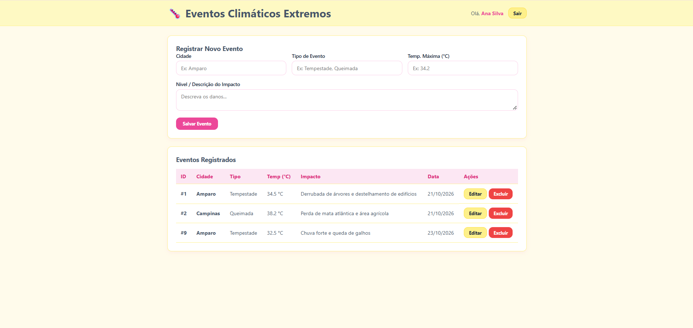

# Painel Climático — Gestão de Eventos Ambientais

> Sistema web desenvolvido para o registo, monitorização e gestão de eventos climáticos por utilizador, construído com uma interface moderna na paleta de cores **Rosa e Amarelo Manteiga**, acoplado a uma API REST robusta em Node.js com Prisma ORM e MySQL.

---

## Sumário
1. [Objetivo da Atividade](#-objetivo-da-atividade)
2. [ Funcionalidades Principais](#-funcionalidades-principais)
3. [ Tecnologias Utilizadas](#-tecnologias-utilizadas)
4. [Estrutura do Projeto](#-estrutura-do-projeto)
5. [ Guia de Instalação e Execução](#-guia-de-instalação-e-execução)
6. [ Rotas da API (Back-End)](#-rotas-da-api-back-end)
7. [ Como Testar a Aplicação](#-como-testar-a-aplicação)
8. [ Capturas de Tela](#-capturas-de-tela)

---

## Objetivo da Atividade
O objetivo principal é o desenvolvimento completo da camada de **Front-End** (`HTML5`, `CSS3` e `JavaScript Vanilla`), garantindo a comunicação assíncrona com uma API REST existente de forma rigorosa. O projeto implementa os requisitos funcionais exigidos:
* **RF001:** Efetuar o login validando as credenciais do utilizador contra a base de dados, gerindo o fluxo de sessão de forma segura.
* **RF002:** Exibir a página Home personalizada com o nome do utilizador autenticado, opção de término de sessão (Logout) e um **CRUD completo** (Criar, Ler, Atualizar e Excluir) de eventos climáticos associados.

---

##  Funcionalidades Principais
* **Autenticação Segura:** Controlo de acesso baseado em credenciais armazenadas de forma persistente e segura (`localStorage`).
* **Isolamento de Dados por Utilizador:** Listagem inteligente que filtra automaticamente os registos para exibir apenas os eventos criados pela conta ativa no momento.
* **Interface Dinâmica e Responsiva:** Formulários inteligentes que alternam automaticamente entre o modo de registo de novo evento e o modo de edição de um registo existente.
* **Feedback Visual Imediato:** Alertas de confirmação para exclusão e notificações de erro amigáveis em caso de falhas na requisição HTTP.

---

##  Tecnologias Utilizadas

### **Front-End (`/web`)**
* **HTML5 Semantic:** Estruturação limpa e acessível.
* **CSS3 Moderno:** Utilização de Flexbox, CSS Grid, variáveis de cores personalizadas e design responsivo com a paleta *Rosa e Amarelo Manteiga*.
* **JavaScript (ES6+):** Manipulação avançada do DOM, API Fetch para requisições assíncronas assentes em JSON e gestão de estado local.

### **Back-End & Base de Dados**
* **Node.js & Express:** Servidor API RESTful.
* **Prisma ORM:** Mapeamento objeto-relacional para gestão da base de dados.
* **MySQL:** Base de dados relacional para persistência de utilizadores e eventos.

---

## Estrutura do Projeto

```text
projeto-climatico/
│
├── src/                  # Código-fonte do Back-End (Intocado)
│   ├── controllers/      # Lógica de negócio (evento.controller.js, etc.)
│   ├── routes/           # Definição de rotas (evento.routes.js, etc.)
│   └── data/             # Configuração do Prisma
│
├── web/                  # Código-fonte do Front-End
│   ├── index.html        # Página principal (Login e Home SPA)
│   ├── style.css         # Estilização visual (Paleta Rosa e Amarelo Manteiga)
│   └── script.js         # Lógica de consumo da API e manipulação do DOM
│
├── prints/               # Pasta destinada às capturas de tela do sistema
│   ├── login.png
│   └── inicio.png
│
├── package.json          # Dependências e scripts do Node.js
└── README.md             # Documentação oficial do projeto

```

---

## Guia de Instalação e Execução

### **Passo 1: Configurar e Executar o Back-End**

1. Certifique-se de ter o **Node.js** e o **MySQL** instalados e configurados na sua máquina.
2. Na raiz do projeto, instale as dependências do servidor:
```bash
npm install

```


3. Configure o ficheiro `.env` com as credenciais da sua base de dados MySQL e execute as migrações do Prisma se necessário.
4. Inicie o servidor da API:
```bash
npm run dev
# ou
node src/server.js

```


*O servidor ficará ativo em `http://localhost:3000`.*

### **Passo 2: Executar o Front-End**

1. Entre na pasta `web` do projeto.
2. Abra o ficheiro `index.html` utilizando a extensão **Live Server** no seu editor de código (VS Code) ou abra-o diretamente no seu navegador web preferido.

---

## Rotas da API (Back-End Consumidas)

O front-end comunica diretamente com os seguintes endpoints pré-definidos na API:

| Método | Rota | Descrição |
| --- | --- | --- |
| `POST` | `/usuario/login` | Valida o e-mail e palavra-passe do utilizador. |
| `GET` | `/evento/listar` | Retorna a lista completa de eventos climáticos registados. |
| `POST` | `/evento/cadastrar` | Cria um novo evento climático associado a um utilizador. |
| `PUT` | `/evento/atualizar/:id` | Atualiza os dados de um evento existente pelo ID. |
| `DELETE` | `/evento/excluir/:id` | Remove um evento específico da base de dados pelo ID. |

---

##  Como Testar

1. **Aceder ao Sistema (RF001):**
* Abra o front-end. Insira as credenciais de um utilizador registado na sua base de dados MySQL (ex: e-mail e palavra-passe).
* Clique em **"Entrar"**. O sistema validará as credenciais e redirecionará para o painel de controlo.


2. **Gerir Eventos Climáticos (CRUD - RF002):**
* **Listar:** Verifique que a tabela na página Home exibe apenas os registos pertencentes à sua conta.
* **Cadastrar:** Preencha os campos *Cidade*, *Tipo de Evento*, *Temp. Máxima* e a *Descrição do Impacto*, e clique em **"Salvar Evento"**.
* **Atualizar:** Clique no botão **"Editar"** numa linha da tabela, altere os campos desejados no formulário (que mudará para o modo de edição) e clique em **"Atualizar Evento"**.
* **Excluir:** Clique no botão **"Excluir"** para remover o registo permanentemente após confirmação.
* **Terminar Sessão:** Clique no botão **"Sair"** no topo da página para limpar a sessão e retornar ao ecrã de login.


---

## Capturas de Tela

###  1. Login

```markdown


```

---

###  2. Painel Principal 

```markdown


```

```

```